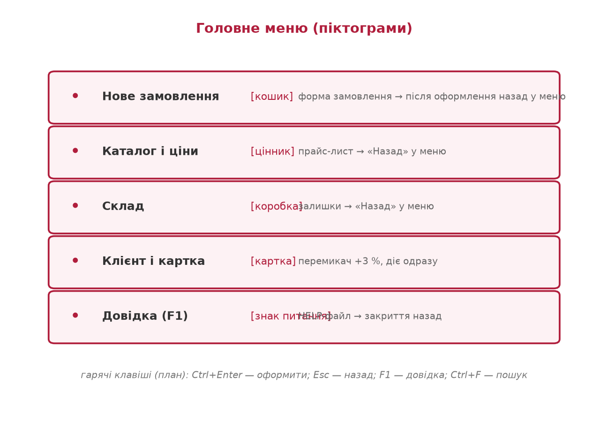
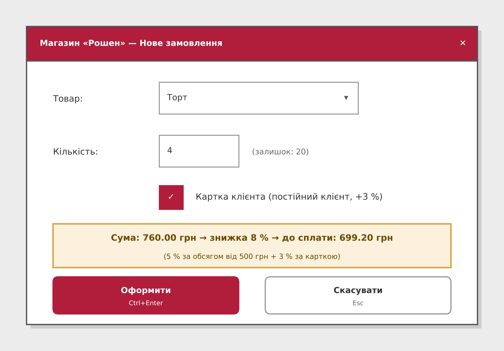
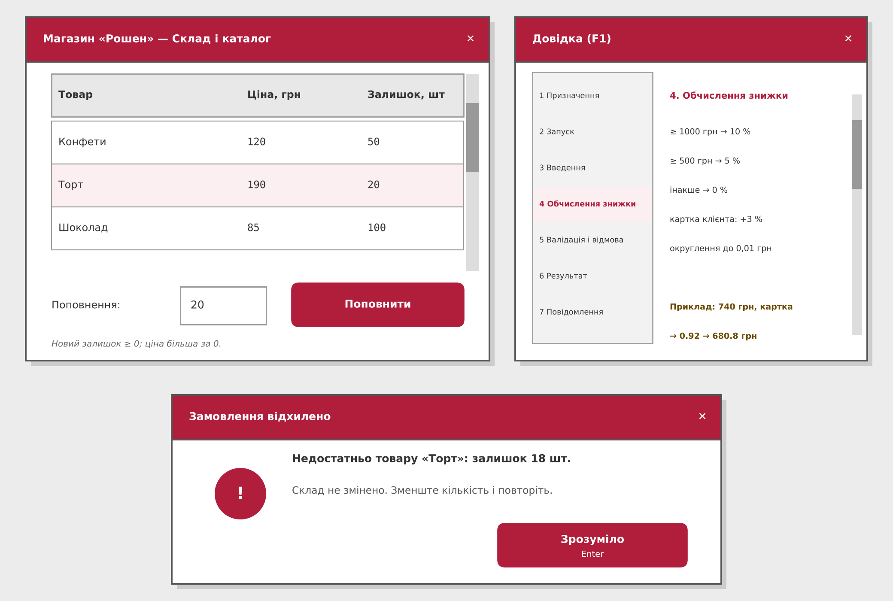

# Меню, діалоги та елементи керування ПЗ магазину «Рошен»

Документ до ЛР6 (варіант 13). Для консольного прототипу зафіксовано
фактичну поведінку; візуальну оболонку реалізовано у ЛР6 файлом `gui.py`
(Tkinter, запуск `python gui.py`) — вікно «Нове замовлення» за макетом
`img/mockup_zamovlennya.png`, склад — таблицею в головному вікні, довідка —
окремим вікном (F1), меню «Файл/Довідка» та підказки у статус-барі; решта
проєктних рішень позначено «(план)».

## 1. Режими роботи та точки повернення

| Режим | Вхідна точка | Хто викликає | Точка повернення (відновлення стану) |
|---|---|---|---|
| демонстраційний | `python roshen_shop.py` | викладач, касир | завершення процесу; стан складу живе в межах запуску |
| бібліотечний | `import roshen_shop`; `calc_discount`, `process_order` | інші модулі | `None` — відмова; склад гарантовано не змінено; увага: імпорт модуля також виконує демонстраційний `main()` (виводить рядок) — відомий недолік прототипу, у тестах вивід перехоплюється |
| тестовий | `python -m unittest discover -s tests` | CI, розробник | код 0 — успіх (26 тестів); 1 — регресія |
| довідковий | `docs/HELP_Магазин_Рошен.md` | користувач | розділи 1–7 довідки |

## 2. Схема меню і список піктограм

Консольний прототип об'єкта «меню» не має: єдина центральна дія —
обробити замовлення. Схема режимів (поточна спіраль):

```
roshen_shop
├── розрахунок знижки ─── calc_discount(total, is_member) ──→ сума
├── обробка замовлення ── process_order(order, stock, ...) ─→ сума | None
├── склад і залишки ───── параметр stock (словник) ─────────→ читання / зміна
└── вихід ─────────────── завершення процесу
```

Схема меню візуальної оболонки (план наступної спіралі; малюнок — `img/menu_diagram.png`):

```
Головне меню (піктограми)
├── Нове замовлення ..... (кошик)   форма замовлення
├── Каталог і ціни ...... (цінник)  прайс-лист
├── Склад ............... (коробка) залишки
├── Клієнт і картка ..... (картка)  знижка +3 %
└── Довідка ......... (знак питання) HELP-файл
```

Список піктограм (план; кожна має підпис, дію і пункт повернення):

| Піктограма | Підпис | Дія | Точка повернення |
|---|---|---|---|
| кошик | Нове замовлення | відкриття форми замовлення | після оформлення → головне меню |
| цінник | Каталог і ціни | перегляд/редагування прайс-листа | «Назад» → головне меню |
| коробка | Склад | перегляд/поповнення залишків | «Назад» → головне меню |
| картка | Клієнт і картка | увімкнення ознаки постійного клієнта | перемикач діє одразу |
| знак питання | Довідка | відкриття HELP-файлу | закриття вікна → попередній екран |



Концептуальна модель продукту (чотири рівні складності, `img/koncept_model.png`):


## 3. Макети діалогів (консольний прототип — як є)

Макет демонстраційного сценарію (єдиний тип діалогу «виклик — результат»):

```
$ python roshen_shop.py
До сплати: 680.8
```

Макет наскрізного діалогу касира (послідовність викликів process_order):

```
виклик 1: process_order({"Торт": 2, "Шоколад": 3}, stock, prices, True)
       →  584.2            # прийнято: 635 грн, знижка 8 %; Торт: 20 → 18, Шоколад: 100 → 97
виклик 2: process_order({"Торт": 21}, stock, prices, False)
       →  None             # відмова: 21 > залишку 18; склад не змінено
```

Правило діалогу: жоден виклик не змінює склад, доки не пройдені всі
перевірки (R-02, R-03, R-05) — відмова безпечна для обліку.

## 4. Макети вікон візуальної оболонки (план)

Макет вікна «Нове замовлення» (склад полів — за п. 3 ТЗ; приклад: Торт × 4 = 760 грн, картка клієнта):

```
+--------------------------------------------------------+
| Магазин «Рошен» — Нове замовлення                 [X]  |
+--------------------------------------------------------+
| Товар:       [ Торт            v ]                     |
| Кількість:   [ 4         ]  (залишок: 20)              |
| Картка клієнта:  [x]  (постійний клієнт, +3 %)         |
|                                                        |
| Сума: 760.00 грн → знижка 8 % → до сплати: 699.20 грн  |
|                                                        |
| [ Оформити (Ctrl+Enter) ]        [ Скасувати (Esc) ]   |
+--------------------------------------------------------+
```

Компоненти вікон по пунктах меню (план):

| Пункт меню | Компоненти вікна | Валідація на вході |
|---|---|---|
| Нове замовлення | список товару, поле кількості, прапорець картки, кнопки | 1 ≤ n ≤ залишок (R-05, R-03); товар ∈ прайс-листу (R-02) |
| Каталог і ціни | таблиця name/price, редагування цін | ціна > 0 |
| Склад | таблиця name/stock, поле поповнення | новий залишок ≥ 0 |
| Клієнт і картка | перемикач is_member | — |
| Довідка | вікно довідки | — |

## 5. Гарячі клавіші та підказки

Гарячі клавіші (план візуальної оболонки; в консолі не застосовуються):

| Сполучення | Дія | Доступна у |
|---|---|---|
| Ctrl+Enter | оформити замовлення | вікно «Нове замовлення» (план) |
| Esc | скасувати діалог, назад | усі вікна оболонки (план) |
| F1 | виклик довідки (HELP-файл) | усі вікна оболонки (план) |
| Ctrl+F | пошук товару в каталозі/складі | таблиці каталогу і складу (план) |

Підказки (спливаючі — план) і фактична інформаційна підтримка прототипу:

| Елемент | Текст підказки | Фактична підтримка зараз |
|---|---|---|
| поле «Кількість» | «Додатне ціле, не більше залишку» | відхилення R-05/R-03 повертає None |
| поле «Товар» | «Виберіть товар із прайс-листа» | відхилення R-02 повертає None |
| прапорець «Картка» | «Знижка постійного клієнта +3 %» | додає 0.03 до ставки в calc_discount |
| кнопка «Оформити» | «Списати товар зі складу та показати суму» | списання після всіх перевірок (R-04) |

Структура довідки (HELP-файл, `docs/HELP_Магазин_Рошен.md`): 1. Призначення;
2. Запуск; 3. Введення; 4. Обчислення знижки; 5. Валідація і відмова;
6. Результат; 7. Повідомлення про помилки.



Макети решти типів діалогів — таблиця «Склад і каталог», довідка (F1) і
повідомлення про відмову — зібрано на одному малюнку:



## 6. Повідомлення про відмову (план)

`process_order` повертає лише `None` без причини відмови, тому оболонка
сама визначає причину тими самими перевірками й показує користувачеві
текст:

| Причина (вимога) | Текст повідомлення |
|---|---|
| товар відсутній у прайс-листі (R-02) | «Товар відсутній у прайс-листі» |
| кількість більша за залишок (R-03) | «Недостатньо товару «Торт»: залишок 18 шт.» |
| кількість нульова або від'ємна (R-05) | «Кількість має бути більшою за нуль» |

У кожному разі склад не змінюється (атомарність відмови).
